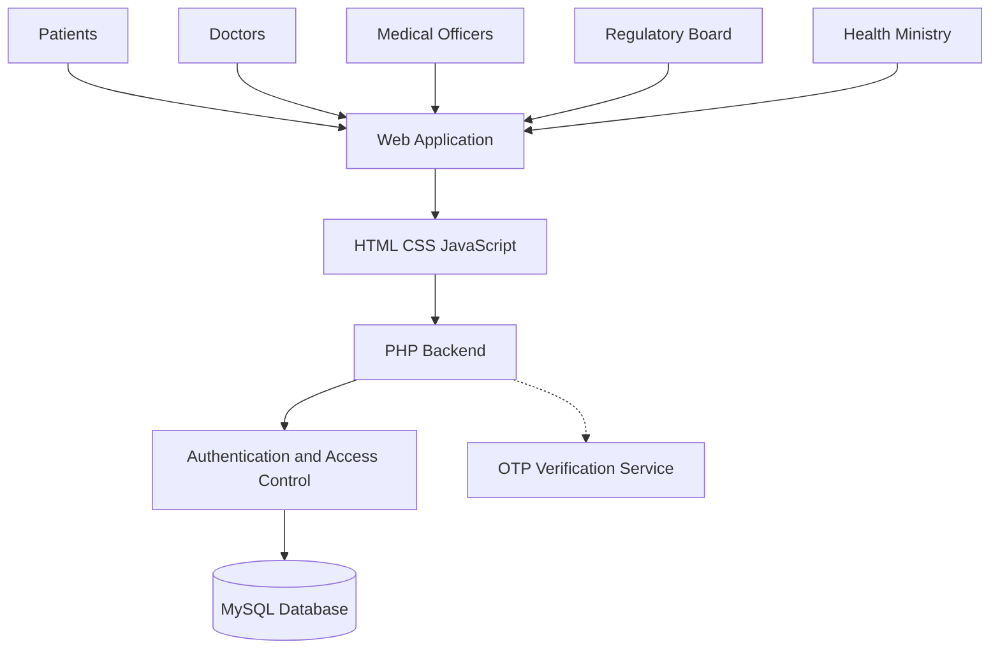

# National Health & Medical Record Directory (NHMRD)

### A Unified Digital Health Record & Doctor Regulation Platform for Bangladesh

NHMRD is a proposed centralized digital healthcare platform designed to modernize healthcare record management and professional medical regulation across Bangladesh. It aims to connect patients, doctors, hospitals, clinics, diagnostic centers, and regulatory authorities through a unified digital ecosystem.

The platform aims to make medical histories more accessible, improve continuity of care, strengthen doctor credential verification, and support faster emergency response.

---

## 📌 Table of Contents

- [Overview](#-overview)
- [Problem Statement](#-problem-statement)
- [Project Objectives](#-project-objectives)
- [Core Features](#-core-features)
- [User Roles](#-user-roles)
- [Technology Stack](#-technology-stack)
- [System Architecture](#-system-architecture)
- [Project Scope](#-project-scope)
- [Development Methodology](#-development-methodology)
- [Getting Started](#-getting-started)
- [Dependencies and Future Integrations](#-dependencies-and-future-integrations)
- [Security and Privacy](#-security-and-privacy)
- [Development Team](#-development-team)
- [Future Enhancements](#-future-enhancements)
- [Disclaimer](#-disclaimer)
- [Project Report](#-read-the-report)

---

## 🌐 Overview

Medical records in Bangladesh can be distributed across multiple healthcare facilities, making it difficult to obtain a complete patient history when needed. NHMRD proposes a unified system to help address this challenge through centralized digital health records and controlled access.

The system is designed to support lifelong patient records linked to a National Identity (NID) card or Birth Registration Certificate, secure doctor access, professional credential verification, and administrative oversight.

### Why NHMRD?

- 🏥 **Unified Healthcare Records:** Bring medical information from different healthcare facilities into one connected ecosystem.
- 👨‍⚕️ **Doctor Regulation:** Support professional registration, credential verification, and activity monitoring.
- 🔐 **Secure Record Access:** Introduce OTP-based patient consent and role-based authorization.
- 🚑 **Emergency Readiness:** Make critical information, such as blood group, allergies, and chronic conditions, easier to access when authorized.
- 📋 **Digital Record Management:** Reduce dependence on fragmented paper-based documentation.

## ❗ Problem Statement

The project addresses several challenges in healthcare record management and medical regulation:

1. **Fragmented Medical History** — Patient records may be scattered across different hospitals, clinics, and diagnostic centers.
2. **Incomplete Clinical Information** — Healthcare professionals may lack access to relevant historical information when treating patients.
3. **Doctor Credential Gaps** — A unified mechanism for professional verification and regulatory monitoring is needed.
4. **Paper-Based Vulnerabilities** — Manual records can be lost, damaged, or difficult to retrieve efficiently.
5. **Emergency Coordination Challenges** — Finding suitable blood donors for critical patients can be difficult without a coordinated digital system.

## 🎯 Project Objectives

- Establish a unified digital health record ecosystem for public and private healthcare facilities.
- Maintain centralized, lifelong medical records for citizens.
- Link patient profiles to NID or Birth Registration information.
- Enable authorized doctors to review relevant patient histories.
- Support doctor registration, verification, and regulatory oversight.
- Introduce hospital and clinic registration and licensing workflows.
- Improve emergency access to critical health information.
- Reduce duplicate documentation and unnecessary repeat tests where clinically appropriate.

## ✨ Core Features

### 👤 Patient Management
- Patient profile creation and management.
- Identity-linked patient records.
- Medical history and treatment record access.
- Vaccination and prescription history.
- Surgery, allergy, and chronic condition records.
- Patient approval of doctor access through OTP verification.

### 🩺 Doctor Management
- Doctor profile management.
- Professional credential registration and verification.
- Patient access requests using NID-based identification and OTP verification.
- Diagnosis and treatment record management.
- Access to authorized patient medical histories.

### 🏥 Hospital and Clinic Management
- Hospital and clinic registration.
- Operating license management.
- Healthcare facility profile management.
- Administrative oversight of registered facilities.

### 🔐 Security and Medical History
- OTP-based access verification.
- Role-based access control.
- Controlled access to sensitive patient information.
- Append-only medical history, designed to prevent doctors and patients from deleting existing medical records.

### 🩸 Emergency Blood Donor Matching
- Digital blood donor information.
- Blood group-based donor matching.
- Support for identifying potential donors for patients requiring urgent blood transfusions.

### 🏛️ Administrative and Regulatory Dashboards
- Patient and doctor profile administration.
- Doctor credential verification and monitoring.
- Hospital registration and licensing.
- System-wide administrative oversight.
- Death certificate record management.
- Specialized dashboards for regulatory authorities.

---

## 👥 User Roles

The proposed system includes the following user roles:

| Role | Main Responsibilities |
|---|---|
| **Patient** | View personal medical records, prescriptions, vaccinations, and treatment history; approve doctor access through OTP. |
| **Doctor** | Request patient record access, manage professional profiles, and add diagnosis and treatment records. |
| **Admin / Medical Officer** | Create patient profiles, manage medical records, and support administrative workflows. |
| **National Doctor Regulatory Board** | Register and verify doctors, assign hospitals, monitor professional activity, and manage credentials. |
| **National Health Ministry** | Register healthcare facilities, issue operating licenses, and oversee system-wide compliance. |

## 🛠️ Technology Stack

The proposed technology stack is based on the project specification.

| Component | Technology |
|---|---|
| Frontend | HTML5, CSS3, JavaScript |
| Backend | PHP |
| Database | MySQL |
| Development Server | Apache |
| Local Development Environment | XAMPP |
| Deployment | Cloud hosting |
| Access Verification | OTP-based verification |

## 🏗️ System Architecture

NHMRD follows a client-server architecture in which the frontend communicates with a PHP backend, which interacts with a MySQL database.



*Note: This diagram represents the proposed architecture. Actual implementation details may vary.*

## 📋 Project Scope

### Included in the Proposed Scope

- Patient, doctor, and hospital profile management.
- OTP-based verification for secure patient record access.
- Role-based authorization for patients, doctors, administrators, the Ministry, and the Regulatory Board.
- Append-only medical history.
- Doctor registration and credential verification.
- Hospital registration and licensing workflows.

### Outside the Initial Scope

- Native mobile application development.
- AI-based diagnosis and predictive analytics.
- Real-time hospital billing and insurance integration.
- International interoperability with foreign healthcare systems.

## 🔄 Development Methodology

The project follows an **Agile development methodology**, emphasizing iterative implementation and continuous feedback.

The proposed development lifecycle is:

1. **Requirement Gathering** — Identify stakeholder needs and system requirements.
2. **System Design** — Plan the database, application architecture, interfaces, and access controls.
3. **Development** — Implement the frontend, backend, database, and required modules.
4. **Testing** — Validate features, permissions, data integrity, and application behavior.
5. **Deployment** — Prepare the application for its intended hosting environment.
6. **Feedback and Improvement** — Refine the system through stakeholder feedback.

## 🚀 Getting Started

The following instructions describe a general local development setup for the PHP/MySQL technology stack. Adapt the steps to the actual repository structure and database files.

### Prerequisites

Install the following software:

- [Git](https://git-scm.com/)
- [XAMPP](https://www.apachefriends.org/)
- A modern web browser
- A code editor, such as [Visual Studio Code](https://code.visualstudio.com/)

### Installation

**1. Clone the repository**

```bash
git clone https://github.com/abuhurairarahi/nhmrd.git
```

**2. Move the project into your XAMPP web directory**

For Windows, the usual directory is:

```text
C:\xampp\htdocs\nhmrd
```

**3. Start Apache and MySQL**

Open the XAMPP Control Panel and start the Apache and MySQL services.

**4. Configure the database**

- Open phpMyAdmin at `http://localhost/phpmyadmin/`.
- Create the database required by the project.
- Import the project's SQL file if one is included.
- Update the PHP database configuration with the appropriate host, database name, username, and password.

**5. Launch the application**

Open the following address in your browser:

```text
http://localhost/nhmrd/
```

If the project uses a different entry point, folder structure, or database configuration, use the appropriate path and setup instructions.

> **Important:** A database export, configuration file, and any required OTP credentials must be available and correctly configured before the corresponding functionality can run.

## 🔗 Dependencies and Future Integrations

The proposed nationwide platform depends on external services and institutional cooperation, including:

- Authorized access to National ID and Birth Registration databases.
- Cooperation with the National Doctor Regulatory Board.
- Cooperation with the National Health Ministry.
- An SMS or email gateway for OTP delivery.
- Government policy approval for nationwide deployment.

These integrations require appropriate authorization and are not implied to be operational merely because they appear in the project proposal.

## 🔒 Security and Privacy

NHMRD is intended to handle sensitive medical and identity information. Security and privacy must therefore be considered throughout development.

Key design priorities include:

- Role-based access control and server-side authorization.
- OTP verification for relevant access workflows.
- Patient consent and controlled medical record access.
- Secure storage and handling of authentication credentials.
- Protection against SQL injection and common web vulnerabilities.
- Appropriate audit trails for sensitive operations.
- Append-only medical history and traceable record updates.
- Secure deployment and database backup procedures.

Any production deployment should undergo appropriate security testing, privacy review, and compliance assessment before real patient information is used.

## 👨‍💻 Development Team

The project proposal identifies the following team members:

| Team Member | Student ID | Role |
|---|---|---|
| Sanjana Farhin | 0112420212 | Idea Designer & Developer |
| Md. Abu Huraira Rahi | 0112420204 | Project Leader & Idea Designer |
| Hasibur Rahman | 0112231066 | Role not specified in the proposal - Absent |

## 🔮 Future Enhancements

Potential future development directions include:

- 📱 Mobile application integration.
- 🪪 Secure digital health passports for citizens.
- 🔗 Broader integration with authorized healthcare facilities.
- 🚑 Improved emergency information access and donor coordination.
- 🤖 Exploration of AI-assisted healthcare capabilities, subject to separate scope, validation, and safety requirements.
- ☁️ Scalable cloud deployment for wider availability.

These are proposed future directions rather than claims of existing functionality.

## ⚠️ Disclaimer

NHMRD is a healthcare technology project proposal intended to explore digital medical record management and doctor regulation in Bangladesh. The proposed features, external integrations, and nationwide deployment depend on implementation, testing, institutional authorization, and applicable legal and privacy requirements.

This project should not be treated as an officially approved national healthcare platform unless such approval has been independently established.

---

## 📄 Project Information

**Project Name:** National Health & Medical Record Directory (NHMRD)

**Project Category:** Healthcare Management System

**Application Type:** Web Application

**Primary Technologies:** HTML, CSS, JavaScript, PHP, MySQL

**Development Environment:** XAMPP

**Project Lead:** [Md. Abu Huraira Rahi](https://github.com/abuhurairarahi), [Sanjana Farhin Astha](https://github.com/sanjanafarhin)

---

## 🔗 Read the Report

**Download NHMRD Report:** [Download](https://drive.google.com/file/d/10P6FtV-vsToRi4QiVDm3sgxIUAO62ijh/view?usp=drive_link)


*“The function of good software is to make the complex appear simple.” — Grady Booch*
